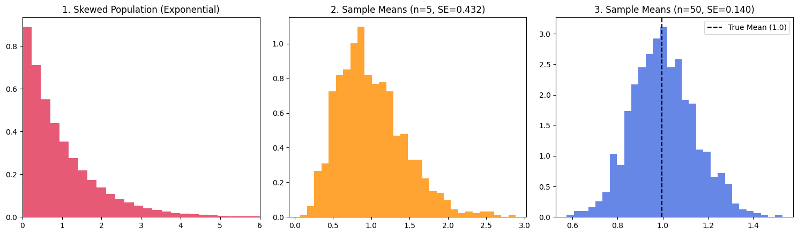

## Project Overview
A Python-based statistical simulation demonstrating the Central Limit Theorem (CLT) by transforming a heavily right-skewed Exponential population into an asymptotically Normal sampling distribution.

## Objectives
* Generate a non-normal, right-skewed Exponential population distribution ($N = 100,000$).
* Simulate repeated random sampling across small ($n = 5$) and large ($n = 50$) sample sizes.
* Verify empirical Standard Error reduction against the theoretical formula $SE = \frac{\sigma}{\sqrt{n}}$.

## Technologies Used
* Python
* NumPy (Stochastic Sampling & Vectorized Array Operations)
* Matplotlib (Multi-stage Density Histograms)

## Mathematical Formulation
* **Population Distribution:** $X \sim \text{Exponential}(\lambda = 1)$, with $\mu = 1.0$ and $\sigma = 1.0$
* **Central Limit Theorem:** $\bar{X}_n \xrightarrow{d} \mathcal{N}\left(\mu, \frac{\sigma^2}{n}\right)$ as $n \to \infty$
* **Standard Error of the Mean:** $\sigma_{\bar{x}} = \frac{\sigma}{\sqrt{n}}$

## Data Visualization

### Asymptotic Convergence of Sample Means

## Key Findings
* **Population Baseline:** Highly skewed distribution with mean $\mu \approx 1.00$ and standard deviation $\sigma \approx 1.00$.
* **Small Sample Regime ($n = 5$):** Empirical Standard Error drops to $\approx 0.447$ (theoretical $1/\sqrt{5} \approx 0.447$), retaining mild positive skewness.
* **Large Sample Regime ($n = 50$):** Distribution converges to a symmetric Gaussian bell curve centered at $1.00$ with empirical Standard Error $\approx 0.141$ (theoretical $1/\sqrt{50} \approx 0.141$).

## Author
Shivam Malik

GitHub: https://github.com/shivamquantlab

## Conclusion
This simulation confirms that regardless of underlying population skewness, the distribution of sample means converges toward a Normal distribution with variance inversely proportional to sample size.
